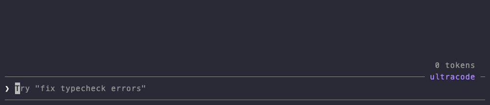
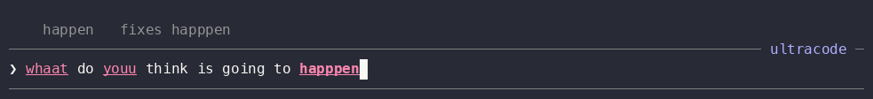
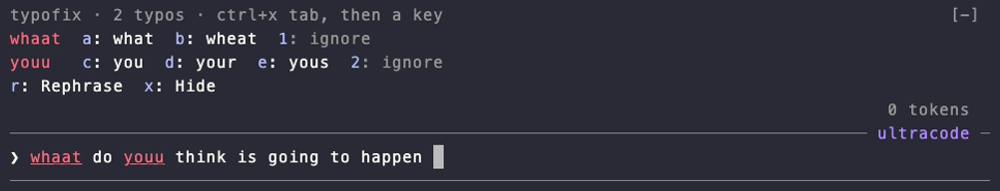
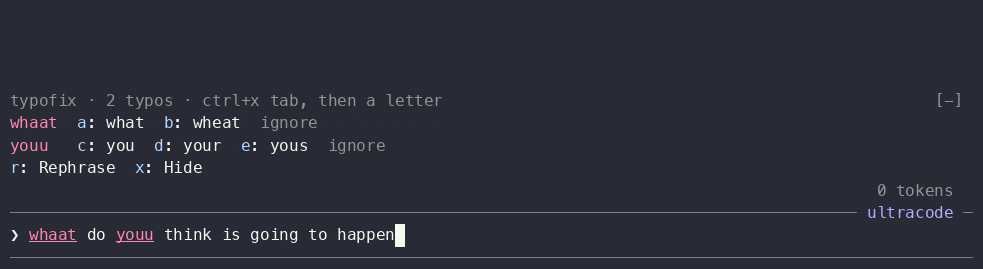
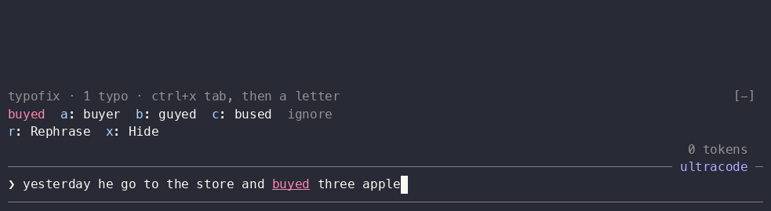

# typofix

A Claude Code mod that checks the spelling and grammar of **your own prompt**
while you type, and offers fixes. It is made for people who write their prompts
in a second language.

- **Live check.** When you stop typing for 0.4 seconds, the mod checks the draft
  with your computer's spell checker. Each mistake gets an underline (your
  theme's error color for spelling, its warning color for grammar). A band above
  the prompt lists the mistakes with their fixes; with no mistakes it shows
  nothing. It never blocks Enter.
- **Rephrase with Haiku, only when you ask.** Press `r` in the band while it
  lists mistakes, or run `/rephrase <text>` for any text. Haiku writes 3
  versions of the whole draft: **fixed** (only spelling and grammar),
  **natural** (how a native speaker would say it) and **short**. Pick one, and
  it replaces the draft.



## Install

typofix needs Claude Code 2.1.300 or later.

```shell
/plugin marketplace add lifebugz/cc-marketplace
/plugin install typofix@lifebugz
```

## Use it

There are two ways to fix a word.

**1. With the cursor right after the word: Tab.** This happens when you just
typed the word, or when you move back to it with the arrow keys. The band steps
aside and the fixes appear directly above the prompt. The word they fix is bold:



| Key   | What it does                                                         |
| :---- | :------------------------------------------------------------------- |
| Tab   | Use the highlighted fix, or the first one when none is highlighted   |
| Down  | Move the highlight; the first Down lands on the first fix            |
| Enter | With no fix highlighted, send the prompt as it is; else use that fix |

**2. With the cursor anywhere: the band shortcut, then a letter.** The band
lists up to 8 mistakes, and each of the first 22 fixes gets its own letter:



Press **ctrl+x tab** (or your own shortcut, below), then the letter. The word is
fixed and you are back in the prompt, ready to type. The letters never use `i`,
`r`, `s` or `x`, and never a digit: a row's digit (`1` to `8`) means "this word
is not a typo" (see [Words that are not typos](#words-that-are-not-typos)).



In the band you can also press a row's digit to ignore that word from now on,
in all your projects (the first row shows `1: ignore`). Press `r` to rephrase
the draft with Haiku, `x` to hide the band until a check finds something new,
and Esc to go back to the prompt. With [fullscreen rendering](https://code.claude.com/docs/en/fullscreen)
on, you can click any fix instead.

**Rephrase the whole draft.** While the band lists mistakes, press the band
shortcut and then `r`. Haiku writes 3 versions, and a number puts one in the
prompt box. For a draft with no mistakes, use `/rephrase` (below):



`/rephrase He go to the store yesterday` shows the 3 rewrites in the transcript
and in the band. Press the band shortcut and then `1`, `2` or `3` (or click one)
to put it in the prompt box.

### Use one key instead of ctrl+x tab

A mod can't add keyboard shortcuts, so each person sets this once. Run
`/keybindings` to open `~/.claude/keybindings.json` and add a `Chat` binding for
the band's focus action:

```json
{
  "bindings": [
    {
      "context": "Chat",
      "bindings": { "ctrl+space": "abovePrompt:focus" }
    }
  ]
}
```

If the file already has a `bindings` list, add the block to it. From the next
check on, the band's header names your key (`ctrl+space, then a key`), and
ctrl+x tab keeps working too.

Pick a key that nothing else on your computer uses. If you type in more than one
language on macOS, check System Settings > Keyboard > Keyboard Shortcuts > Input
Sources first: macOS can use Ctrl+Space to switch the keyboard language.

## Words that are not typos

A spell checker flags some words that are fine, such as names, `ok` or
`frontmatter`. typofix keeps three lists of such words. It never lists a word
in them as a spelling mistake, whichever spell checker flagged it (macOS,
hunspell or enchant-2). Grammar notes still show.

| List    | File                                     | For                    | How a word gets in                              |
| :------ | :--------------------------------------- | :--------------------- | :---------------------------------------------- |
| Shipped | `words.txt` in the typofix folder        | everyone using typofix | a pull request to typofix                       |
| Yours   | `~/.claude/typofix-words.txt`            | you, in every project  | a row's digit in the band, or `/typo-words add` |
| Project | `.claude/typofix-words.txt` in a project | everyone in a project  | `/typo-words share`, then commit the file       |

`~/.claude` is your `CLAUDE_CONFIG_DIR` when you set one. The project list is in
the session's project folder: where the session started, or where `/cd` or a
worktree move took it. When that folder's `.claude` is your own Claude Code
folder (a session started in your home folder, for example), there is no
project list: that file is your list.

Each file is plain text: one word a line, and text after `#` is a comment. Case
does not matter (`Tovan` also covers `tovan`), and neither do straight or curly
apostrophes (`it's`, `it’s`). You can edit the files by hand. typofix reads your
list and the project list at every check, so an edit or a `git pull` counts at
the next check.

| Command                      | What it does                                        |
| :--------------------------- | :-------------------------------------------------- |
| `/typo-words`                | Shows the three lists, each with its file and words |
| `/typo-words add <word…>`    | Adds words to your list                             |
| `/typo-words share <word…>`  | Adds words to the project list, and makes the file  |
| `/typo-words remove <word…>` | Takes words out of your list and the project list   |

A shipped word stays ignored, and `remove` says so. A spell checker's own word
list still works too, but only for that checker: hunspell's `~/.hunspell_en_US`,
for example, does nothing for macOS. typofix's lists work for every checker.

Earlier versions kept ignored words in typofix's own store. The first session
with this version moves them to your list.

## A second checker: hunspell

macOS accepts some typos, such as `whaat`, and misses some in very short drafts.
So on macOS, typofix also asks [hunspell](https://github.com/hunspell/hunspell)
when it is installed: `brew install hunspell`, plus a dictionary (Homebrew ships
none), whose `.aff` and `.dic` files go in `~/Library/Spelling/`. typofix runs
every spell checker in its own folder, so a dictionary or word list in the
folder you opened is never used. A word is listed when either checker flags it. typofix adds hunspell's results for
Latin-script words only, so words in other alphabets come from macOS alone.

hunspell checks only drafts in its dictionary's language. typofix skips it when
the `language` option names another language. With no `language` set, typofix
skips it when macOS is sure (90 % or more) that the draft is in another
language, such as a German draft with the `en_US` dictionary. When macOS is not
sure, as often happens with a short draft, hunspell still checks it.

typofix has its own `hunspell` option for the dictionary (below). It doesn't
read Claude Code's settings, so Claude Code's own
[`spellcheck`](https://code.claude.com/docs/en/interactive-mode#check-spelling-as-you-type)
setting can stay off; typofix underlines on its own.

If hunspell or the dictionary is missing, typofix stops asking it for the rest
of the session and macOS checks alone, with no message (the debug log says why).
A hunspell run that is too slow only skips hunspell for that check; after 3 slow
runs in a row, typofix stops asking it too.

## Settings

| Option     | Default | What it does                                                                                                                                                                                             |
| :--------- | :------ | :------------------------------------------------------------------------------------------------------------------------------------------------------------------------------------------------------- |
| `language` | empty   | The spelling language, such as `en_US` or `de_DE`. On macOS, empty means the spell checker detects the language itself. On Linux, it names the enchant-2 or hunspell dictionary                          |
| `hunspell` | `en_US` | macOS only: the dictionary of the second checker, such as `en_US` or `en_GB`, used only when hunspell is installed. It checks only drafts in its language. `off` means typofix doesn't look for hunspell |

Change them in `/config` or with `/plugin configure typofix`.

On macOS, automatic detection can miss typos in a very short draft. If you write
in one language, set it.

## Platforms

| Platform | Live check                                                                                              | `/rephrase` |
| :------- | :------------------------------------------------------------------------------------------------------ | :---------- |
| macOS    | Built-in spell checker through `osascript`; nothing to install. Spelling and grammar, 44 language codes | Yes         |
| Linux    | `enchant-2` or `hunspell` with a dictionary (install one). Spelling only                                | Yes         |
| Windows  | Not in this version                                                                                     | Yes         |

With no spell checker, the mod shows one notice and no band, and `/rephrase`
still works.

## VS Code

typofix also works in the Claude Code panel of the VS Code extension, but the
panel tells mods nothing about single keys and draws no underlines in its
input. So in the panel:

- typofix reads the draft of the conversation the panel shows, about three
  times a second, and lists its typos in the band above the input. A
  conversation you switch away from is not read.
- You click a fix, `ignore`, `Hide`, `Rephrase` or a rewrite. Buttons have no
  keys there.
- A fix or a rewrite replaces the whole draft and moves the cursor to the end;
  `ignore` leaves the draft alone.
- There are no underlines and no Tab fixes.

For underlines, Tab fixes and keys, run Claude in VS Code's terminal: turn on
the `claudeCode.useTerminal` setting, or run `claude` in the integrated
terminal. Tested with the VS Code extension 2.1.306.

## Limits

- A mistake is underlined as soon as the check finds it while the cursor is at
  the end of the draft, and an underline the check no longer finds goes away at
  once too. The word whose fixes are showing is also bold. With the cursor
  inside the draft, both wait for your next key press (an arrow key is enough),
  because changing the marks at once would move the cursor.
- Claude Code decides where the suggestion list is drawn. The band steps aside so
  the fixes sit next to the prompt; it comes back when the cursor moves on.
- A fix taken with Tab keeps the cursor where it is. In the terminal and the
  desktop app, a fix or an ignore from the band replaces the whole draft, so the
  cursor moves to the end.
- Marking the draft at once replaces it, so a key or paste that lands in that
  same moment is undone; typofix then puts it back. It does this once, so a
  second key in the moment of the put-back can still be lost.
- The live check runs a program on your computer, so it needs a local Claude Code:
  the terminal, the desktop app's local Code tab, or the VS Code extension.
- Grammar checks are best effort. The macOS grammar model does not flag the same
  sentence every time, and it misses errors such as `He go` or `three apple`.
  `/rephrase` catches those.
- The check skips code in backticks, paths, URLs, `@mentions`, and words that
  look like code (`snake_case`, `getUser`, `JSON`, `v2`).
- The output of `/rephrase` and `/typo-words` is a transcript line, so Claude
  reads it too.

## Privacy

The live check runs on your computer. A rephrase sends the draft to Haiku
through your Claude Code session, as one model call on your account.

## Develop

The mod uses the TypeScript, ESLint and Prettier setup at the repository root
(see [`plugins/README.md`](../README.md#develop-a-mod)). From the root:

```shell
bun install
bun run check                   # types, tsc, ESLint, Prettier, tests, validate
bun run lint plugins/typofix    # ESLint on this mod only
claude plugin test plugins/typofix
```

`scripts/spell-macos.js` stays plain JavaScript, because macOS runs it with
`osascript -l JavaScript`, which accepts no TypeScript syntax. It is still
type-checked, as its own project (`scripts/tsconfig.json`), and every function
in it carries JSDoc types. `osascript` calls the `run` function the script sets
on `globalThis`.

`scripts/jxa.d.ts` declares the macOS objects the script uses. In `osascript`,
counts and positions arrive as strings (`"25"`), so the types say `string` and
the script converts them with `Number()`.

Tested with Claude Code 2.1.309 on macOS.
